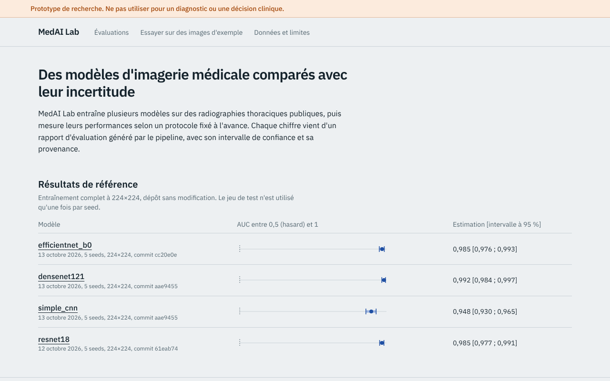
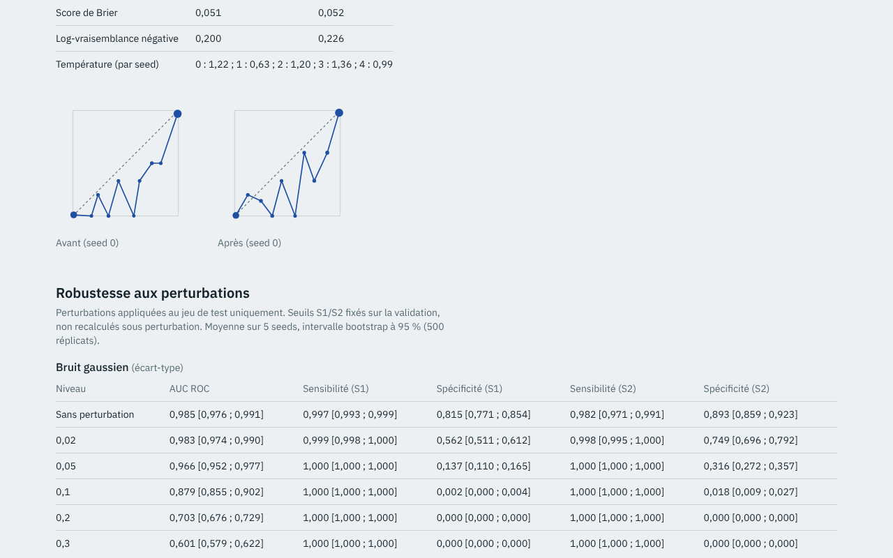
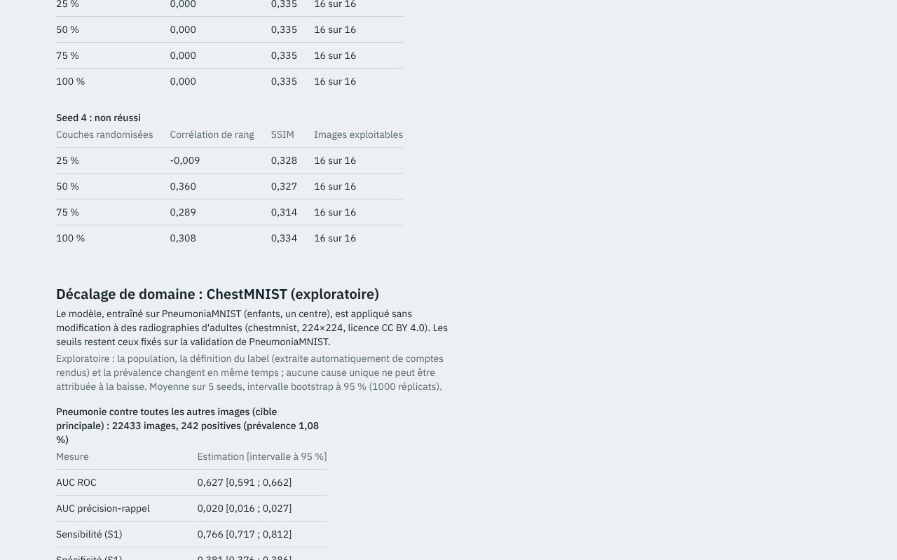

# MedAI Lab

Prototype de recherche : plateforme d'évaluation reproductible de modèles d'IA pour l'imagerie médicale.

**Ne pas utiliser pour un diagnostic ou une décision clinique.** Ce projet n'est pas un dispositif médical.

**[Tableau de bord en ligne](https://abdghni.github.io/medai-lab/)** · [Vidéo de démonstration (45 s)](docs/media/demo.mp4) · [Résultats détaillés](docs/RESULTS.md) · [Étude de cas](docs/CASE_STUDY.md)



## En bref

- **Problème :** les démonstrations d'IA médicale affichent souvent une seule métrique, sans protocole, sans incertitude, sans limites.
- **Approche :** un pipeline hors ligne entraîne et évalue 4 modèles (5 seeds chacun) sur PneumoniaMNIST selon un protocole fixé à l'avance, et écrit des rapports immuables avec leur provenance. L'API et l'interface ne font que lire ces rapports ; aucun chiffre n'apparaît sans rapport source.
- **Résultats :** AUC de 0,95 à 0,99 en domaine, avec comparaisons statistiques corrigées (Holm), calibration, robustesse aux perturbations et test de sanité Grad-CAM.
- **Limites, assumées :** les seuils fixes ne tiennent pas sous perturbation ; le test de sanité Grad-CAM échoue sur certaines seeds ; sur ChestMNIST (adultes, test exploratoire), l'AUC tombe à 0,53-0,64. Prototype de recherche, aucun usage clinique.
- **Ingénierie :** FastAPI, PyTorch, Next.js, tests (Python, web, bout en bout), CI GitHub Actions, Docker, déploiement automatique du tableau de bord statique.

| Analyses d'un modèle | Décalage de domaine (exploratoire) |
|---|---|
|  |  |

Le site en ligne est statique : il affiche les rapports réels, sans inférence en direct. La démo interactive (prédiction et Grad-CAM sur des images d'exemple) fonctionne en local avec l'API.

## État du projet

Phases 1 à 4 réalisées : pipeline, API, interface, comparaison statistique, calibration, robustesse et test de sanité Grad-CAM sont implémentés, testés, et appliqués à de **vrais entraînements** (4 modèles x 5 seeds, PneumoniaMNIST 224x224, GPU T4). Les chiffres ci-dessous sont générés par `scripts/make_results.py` à partir des rapports versionnés ; le détail complet, avec leurs limites, est dans [docs/RESULTS.md](docs/RESULTS.md).

<!-- RESULTS:START -->
| Modèle | AUC [IC 95 %] | Sensibilité S1 | Spécificité S1 | Rapport |
|---|---|---|---|---|
| resnet18 | 0.985 [0.977 ; 0.991] | 0.997 | 0.815 | `resnet18-04e08eb9-20261012T184310Z` |
| simple_cnn | 0.948 [0.930 ; 0.965] | 0.951 | 0.778 | `simple_cnn-a7e858f0-20261013T093409Z` |
| densenet121 | 0.992 [0.984 ; 0.997] | 0.995 | 0.868 | `densenet121-49378193-20261013T100113Z` |
| efficientnet_b0 | 0.985 [0.976 ; 0.993] | 0.995 | 0.823 | `efficientnet_b0-2f9becc1-20261013T212542Z` |
<!-- RESULTS:END -->

Moyenne de 5 seeds, jeu de test (624 images, un seul centre). Les intervalles ne couvrent que l'échantillonnage du test, pas un changement d'hôpital ou d'appareil. Limites principales : un seul jeu de données ; prévalence différente entre validation et test ; seuils fixes qui ne tiennent pas sous perturbation (spécificité ou sensibilité qui s'effondre selon le modèle) ; test de sanité Grad-CAM non satisfait pour toutes les seeds avec resnet18 et densenet121 ; décalage de domaine (ChestMNIST) exploratoire : l'AUC chute à 0,53-0,64 contre 0,95-0,99 en domaine, et les seuils fixes ne tiennent pas. Voir aussi [la fiche modèle](docs/MODEL_CARD.md) et [l'étude de cas](docs/CASE_STUDY.md).

## Principe

Un pipeline Python hors ligne entraîne et évalue les modèles selon un protocole fixé à l'avance ([docs/EVAL_PROTOCOL.md](docs/EVAL_PROTOCOL.md)) et écrit des rapports JSON immuables avec leur provenance (commit, empreintes de la configuration et des données, seed, versions, matériel). L'API et l'interface ne font que lire ces rapports.

- Données : PneumoniaMNIST (MedMNIST v2, CC BY 4.0), voir [docs/DATASETS.md](docs/DATASETS.md) et la fiche de données générée `reports/datasheets/pneumoniamnist_224.json`.
- Le jeu de test n'est utilisé qu'une fois par seed ; l'epoch et les seuils sont choisis sur la validation.
- Intervalles de confiance par bootstrap, 5 seeds par modèle.
- Spécification : [docs/SPEC.md](docs/SPEC.md). Décisions : [docs/adr/](docs/adr/). Backlog : [docs/BACKLOG.md](docs/BACKLOG.md).

## Démarrage

Prérequis : [uv](https://docs.astral.sh/uv/), Node.js 22 et pnpm ; Docker pour la pile complète.

```bash
# Python : installation, qualité, tests
uv sync
uv run ruff check . && uv run mypy && uv run pytest -m "not slow"

# Fiche de données réelle (télécharge PneumoniaMNIST 224x224, environ 214 Mo)
uv run python -m medai_ml datasheet --size 224 --out reports/datasheets/pneumoniamnist_224.json

# Entraînement et évaluation (GPU recommandé ; voir notebooks/colab_train.ipynb)
uv run python -m medai_ml run --config ml/configs/resnet18.yaml

# Pile complète (API sur :8000, interface sur :3000)
docker compose up --build
```

Test de fumée sans GPU (petite résolution, résultats sans valeur scientifique) :
`uv run python -m medai_ml run --config ml/configs/smoke_simple_cnn_28.yaml`

Version statique (rapports précalculés, sans inférence) : `NEXT_PUBLIC_STATIC_EXPORT=1 pnpm build` dans `apps/web` avec l'API locale démarrée produit `apps/web/out`. Le workflow manuel `.github/workflows/pages.yml` la publie sur GitHub Pages une fois la source Pages réglée sur « GitHub Actions ».

## Structure

```
ml/medai_ml/     pipeline : données, entraînement, métriques, seuils, rapports, Grad-CAM
ml/configs/      configurations d'expériences (YAML validé)
services/api/    API FastAPI (rapports, galerie, prédiction, explication)
apps/web/        interface Next.js
gallery/         24 images du jeu de test (CC BY 4.0) utilisées par la démo
reports/         rapports d'évaluation et fiche de données
docs/            spécification, protocole, ADR, backlog, audit
```

## Licences

Code : MIT. Données : voir [docs/DATASETS.md](docs/DATASETS.md) (PneumoniaMNIST : CC BY 4.0, attribution à Kermany et al. 2018 et Yang et al. 2023).
